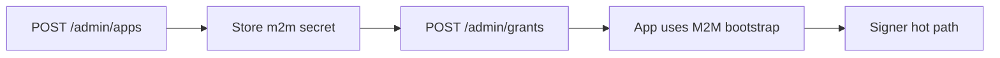

# Clearinghouse administrator API

The clearinghouse **control plane** exposes a small HTTP API for operators. In local and production layouts, requests go through the **Apache DMZ** on the public port; Apache proxies `/api/clearinghouse/*` to the control plane service.

This document covers **administrator-only** routes under `/api/clearinghouse/admin/`. Application owners use separate **app M2M** routes (`/api/clearinghouse/apps/me/*`); those are not described here except where you need credentials produced by admin registration.

## Prerequisites

1. **Stack running** — see [README.md](../README.md):

   ```bash
   export CLEARINGHOUSE_ADMIN_CLIENT_SECRET=<redacted-admin-secret>
   docker compose up --build -d
   ```

2. **Control plane healthy** — if admin calls return Apache `500` with `DNS lookup failure for: clearinghouse-control-plane`, the control plane container is down. Check:

   ```bash
   docker compose ps clearinghouse-control-plane
   docker logs lpclearinghouse-clearinghouse-control-plane-1
   ```

3. **Administrator credentials** — configured via environment on the control plane (not created through this API):

   | Variable | Default (dev) |
   |----------|----------------|
   | `CLEARINGHOUSE_ADMIN_CLIENT_ID` | `clearinghouse-admin` |
   | `CLEARINGHOUSE_ADMIN_CLIENT_SECRET` | *(required; dev compose uses `<redacted-admin-secret>`)* |

   The secret is hashed in Postgres on startup. Changing it requires updating the env var and restarting the control plane so `ensureAdminConfig` can refresh the stored hash.

## Base URL and authentication

| Item | Value |
|------|--------|
| Base URL (local) | `http://127.0.0.1:8080` |
| Admin path prefix | `/api/clearinghouse/admin` |
| Auth | HTTP **Basic** — username = admin client ID, password = admin client secret |

Example header (equivalent to `-u clearinghouse-admin:${CLEARINGHOUSE_ADMIN_CLIENT_SECRET}`):

```http
Authorization: Basic base64(clearinghouse-admin:${CLEARINGHOUSE_ADMIN_CLIENT_SECRET})
```

All admin routes reject requests without valid Basic auth:

| HTTP | `code` | Meaning |
|------|--------|---------|
| 401 | `invalid_token` | Missing `Authorization: Basic` |
| 403 | `invalid_token` | Wrong admin secret |
| 403 | *(varies)* | Authenticated but not an admin actor (should not happen on `/admin/*`) |

Use **HTTPS** and a strong random secret in production; treat the admin secret like a root API key.

---

## Register an application

Creates a new clearinghouse app: database row, Keycloak **public** OIDC client (`app_*`), and **M2M** client (`m2m_*`) for server-side bootstrap.

```http
POST /api/clearinghouse/admin/apps
Content-Type: application/json
```

### Request body

| Field | Required | Description |
|-------|----------|-------------|
| `name` | yes | Human-readable app name |
| `allowedScopes` | no | Space-separated scopes (default: `sign:job openid profile email`) |
| `allowedOrigins` | no | Redirect / web origin patterns for the public client (default in Keycloak: `http://localhost:8080/*` if omitted) |
| `ownerLabel` | no | Free-form label for audit (team, product, etc.) |

### Example

```bash
curl -sS -X POST "http://127.0.0.1:8080/api/clearinghouse/admin/apps" \
  -u "clearinghouse-admin:${CLEARINGHOUSE_ADMIN_CLIENT_SECRET}" \
  -H "Content-Type: application/json" \
  -d '{
    "name": "My App",
    "allowedScopes": "sign:job openid profile email",
    "allowedOrigins": ["http://localhost:8080/*", "http://localhost:3000/*"],
    "ownerLabel": "my-team"
  }'
```

### Response `200`

```json
{
  "app": {
    "id": "app_f18c974f16ff53d2",
    "name": "My App",
    "publicClientId": "app_f18c974f16ff53d2",
    "m2mClientId": "m2m_3e9f257d1a630d3d",
    "allowedScopes": "sign:job openid profile email",
    "status": "active"
  },
  "m2mClientSecret": "<random-secret-shown-once>"
}
```

**Important:** `m2mClientSecret` is returned **only once** at registration (and again only after an explicit rotate). Store it in a secret manager or `.env`; it cannot be retrieved later.

Give the app owner:

- `publicClientId` — end-user OIDC / device login in Keycloak
- `m2mClientId` + `m2mClientSecret` — Dashboard or backend calls to bootstrap signer JWTs

Keycloak provisioning is best-effort: if Keycloak is temporarily unavailable, the DB row may still be created while admin client creation is retried on later operations (rotate, or a new register). Check control plane logs for `[keycloak-admin]` warnings.

---

## List applications

```http
GET /api/clearinghouse/admin/apps
```

### Example

```bash
curl -sS "http://127.0.0.1:8080/api/clearinghouse/admin/apps" \
  -u "clearinghouse-admin:${CLEARINGHOUSE_ADMIN_CLIENT_SECRET}"
```

### Response `200`

```json
{
  "apps": [
    {
      "id": "app_f18c974f16ff53d2",
      "name": "My App",
      "publicClientId": "app_f18c974f16ff53d2",
      "m2mClientId": "m2m_3e9f257d1a630d3d",
      "allowedScopes": "sign:job openid profile email",
      "status": "active",
      "ownerLabel": "my-team",
      "createdAt": "2026-05-29T19:15:33.123Z"
    }
  ]
}
```

Secrets are never included in list responses.

---

## Disable or enable an application

Disabled apps cannot authenticate as app M2M and bootstrap returns `app_disabled`.

```http
POST /api/clearinghouse/admin/apps/{publicClientId}/disable
POST /api/clearinghouse/admin/apps/{publicClientId}/enable
```

`{publicClientId}` is the `app_*` id (same as `app.id` from register/list).

### Examples

```bash
PUBLIC_CLIENT_ID=app_f18c974f16ff53d2

curl -sS -X POST "http://127.0.0.1:8080/api/clearinghouse/admin/apps/${PUBLIC_CLIENT_ID}/disable" \
  -u "clearinghouse-admin:${CLEARINGHOUSE_ADMIN_CLIENT_SECRET}"

curl -sS -X POST "http://127.0.0.1:8080/api/clearinghouse/admin/apps/${PUBLIC_CLIENT_ID}/enable" \
  -u "clearinghouse-admin:${CLEARINGHOUSE_ADMIN_CLIENT_SECRET}"
```

### Response `200`

```json
{ "status": "disabled" }
```

or

```json
{ "status": "active" }
```

### Response `404`

```json
{ "error": "Application not found", "code": "error" }
```

---

## Rotate M2M client secret

Issues a new secret for the app’s `m2m_*` client in Keycloak and updates the hashed secret in Postgres. Previous M2M credentials stop working immediately.

```http
POST /api/clearinghouse/admin/apps/{publicClientId}/rotate-m2m
```

### Example

```bash
curl -sS -X POST "http://127.0.0.1:8080/api/clearinghouse/admin/apps/app_f18c974f16ff53d2/rotate-m2m" \
  -u "clearinghouse-admin:${CLEARINGHOUSE_ADMIN_CLIENT_SECRET}"
```

### Response `200`

```json
{
  "m2mClientId": "m2m_3e9f257d1a630d3d",
  "m2mClientSecret": "new-secret-shown-once"
}
```

Update every deployment that uses the old secret (for example `CLEARINGHOUSE_M2M_CLIENT_SECRET` in Dashboard `.env`).

---

## Issue a credit grant (wei)

Adds prepaid **wei** credits for a specific usage subject under an app’s public client id. Grants are recorded in `signer_credit_grants` and consumed by the usage worker / balance logic.

```http
POST /api/clearinghouse/admin/grants
Content-Type: application/json
```

### Request body

| Field | Required | Description |
|-------|----------|-------------|
| `clientId` | yes | App **public** client id (`app_*`) the grant applies to |
| `usageSubject` | yes | Stable subject identifier (e.g. Keycloak `sub`, external user id) |
| `amountWei` | yes | Credit amount as a decimal string (wei) |
| `usageSubjectType` | no | Label for subject type (default: `external_user_id`) |
| `issuer` | no | OIDC issuer URL stored on the grant (default: control plane `CLEARINGHOUSE_OIDC_ISSUER_URL`) |
| `reason` | no | Audit / ops note |

### Example

```bash
curl -sS -X POST "http://127.0.0.1:8080/api/clearinghouse/admin/grants" \
  -u "clearinghouse-admin:${CLEARINGHOUSE_ADMIN_CLIENT_SECRET}" \
  -H "Content-Type: application/json" \
  -d '{
    "clientId": "app_f18c974f16ff53d2",
    "usageSubject": "demo-user",
    "usageSubjectType": "external_user_id",
    "amountWei": "1000000000000000000",
    "reason": "initial dev credits"
  }'
```

### Response `200`

```json
{ "grantId": "42" }
```

If `CLEARINGHOUSE_REQUIRE_POSITIVE_BALANCE=true`, bootstrap and mint paths require sufficient remaining balance from grants minus usage.

---

## Typical operator workflow



1. **Register** the app; save `m2mClientId` / `m2mClientSecret`.
2. **Grant** credits for test users or production accounts (`usageSubject` must match what bootstrap resolves from the user’s `subjectToken`).
3. Configure the integrator (e.g. Dashboard):

   ```env
   CLEARINGHOUSE_API_URL=http://127.0.0.1:8080
   CLEARINGHOUSE_M2M_CLIENT_ID=m2m_...
   CLEARINGHOUSE_M2M_CLIENT_SECRET=...
   ```

4. Optionally **disable** the app or **rotate** M2M after a leak.

### Dev shortcut: seeded Dashboard app

With `CLEARINGHOUSE_SEED_DASHBOARD_APP=true`, the control plane registers a dashboard app after Keycloak is ready and logs M2M credentials once:

```text
[clearinghouse] dashboard M2M secret (store securely): ...
```

Copy those into `CLEARINGHOUSE_M2M_CLIENT_ID` / `CLEARINGHOUSE_M2M_CLIENT_SECRET` in `.env`.

---

## App owner API (M2M)

Routes under `/api/clearinghouse/apps/me/*` use the **application M2M** client (not the administrator client). The Dashboard device flow uses these for programmatic user tokens.

### Upsert app user

```http
POST /api/clearinghouse/apps/me/users
Authorization: Basic m2m_…:secret
Content-Type: application/json

{
  "externalUserId": "demo-user",
  "email": "demo-user@example.com",
  "firstName": "Demo",
  "lastName": "User"
}
```

Creates a Keycloak realm user (if missing) and a `clearinghouse_app_users` row. Idempotent when the user already exists.

### Mint user access token

```http
POST /api/clearinghouse/apps/me/users/{externalUserId}/token
Authorization: Basic m2m_…:secret
Content-Type: application/json

{ "scope": "openid sign:job" }
```

Returns a Keycloak user access token for the public client linked to this M2M app. Used as `subject_token` for RFC 8693 device approval.

Requires `CLEARINGHOUSE_CREDENTIAL_ENCRYPTION_KEY` on the control plane.

---

## Audit and errors

Admin actions write rows to the clearinghouse audit log (`app.register`, `app.set_status`, `app.rotate_m2m`, `grant.issue`) with the admin client id as actor.

| HTTP | Typical cause |
|------|----------------|
| 400 | Malformed JSON or validation error |
| 401 / 403 | Auth failure (see above) |
| 404 | Unknown `publicClientId` on enable/disable/rotate |
| 405 | Wrong HTTP method |
| 500 | Unhandled server error; check control plane logs |

Apache may return `500 Proxy Error` with `DNS lookup failure for: clearinghouse-control-plane` when the control plane container is not running—fix the backend, not the curl command.

---

## Related documentation

- [signer/README.md](../README.md) — full stack, roles, Compose profiles
- App M2M bootstrap and balance: `/api/clearinghouse/apps/me/bootstrap`, `/api/clearinghouse/apps/me/balance` (Basic auth with **M2M** credentials, not admin)
- Keycloak realm imports: `signer/keycloak/realm-clearinghouse.json` (dev), `realm-clearinghouse.base.json` (production baseline)
